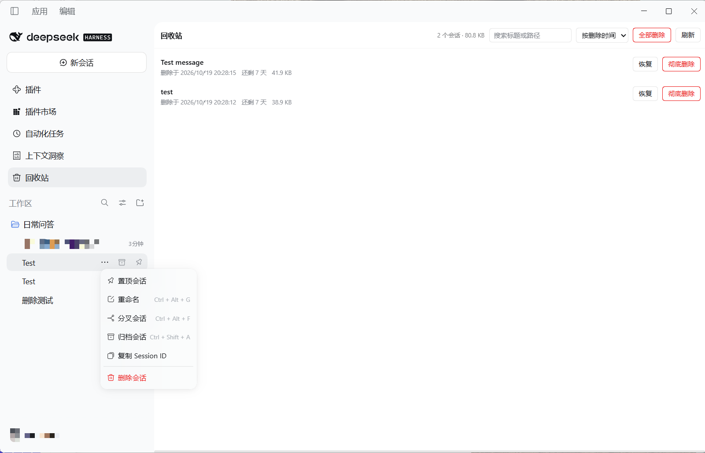
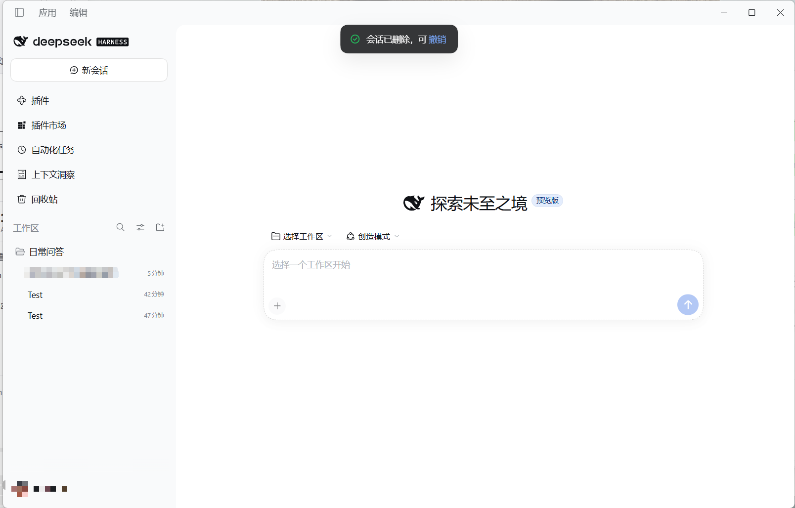
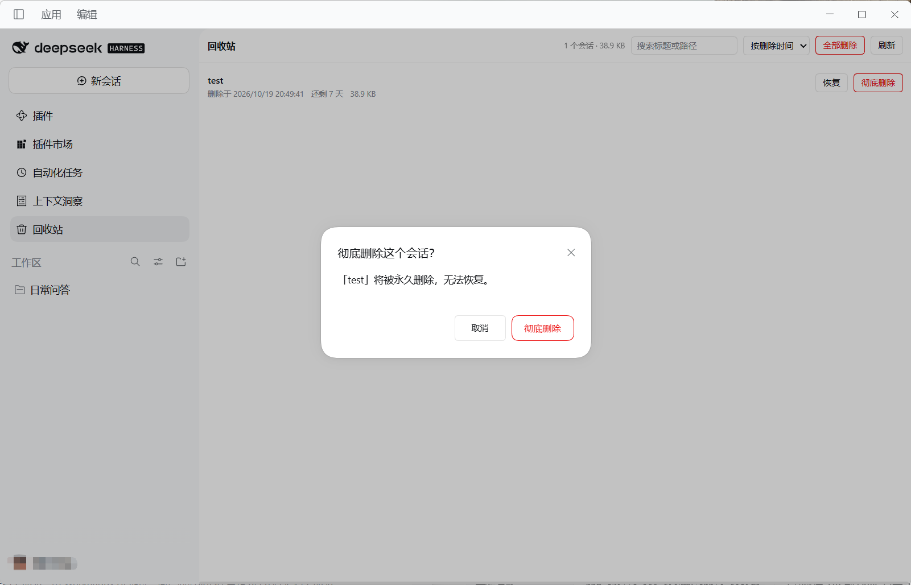
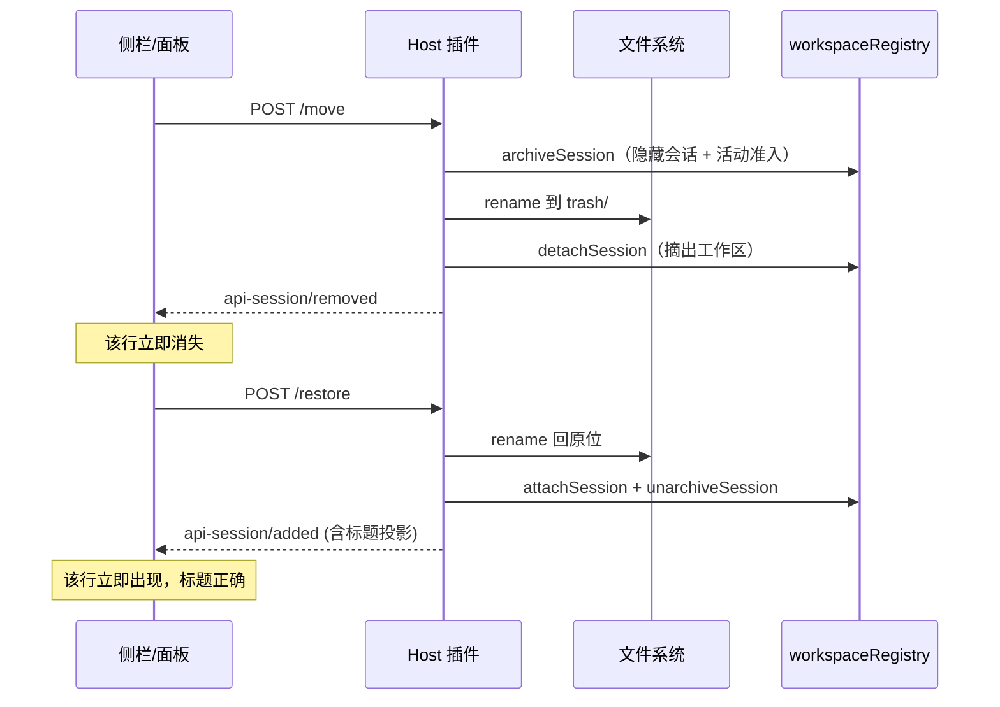

<div align="center">

# 🗑️ dsh-session-trash

**给 DeepSeek Harness 补上「可恢复的会话删除」**

删错了？7 天内随时找回来。

[](https://www.npmjs.com/package/@lazyra/dsh-session-trash)
[](#-快速开始)
[](LICENSE)
[](https://github.com/deepseek-ai/deepseek-harness)
[](#测试)
[](#开发)
[](https://github.com/LazyRa/dsh-session-trash/pulls)

[快速开始](#-快速开始) · [功能](#-功能) · [使用](#-使用) · [配置](#-配置) · [工作原理](#-工作原理) · [常见问题](#-常见问题) · [开发](#-开发)

</div>

---

## 为什么需要它

DSH 官方只有**归档**（archive）——归档是把会话藏起来，可以反悔；但**删除**这个动作官方没有提供。

你可能遇到过这些情况：

- 会话列表越堆越长，想清理掉不用的
- 手滑点错，把还要用的会话处理掉了
- 想彻底删掉某些内容，却只能归档，数据还占着磁盘

这个插件把「删除」做成安全版本：**不是抹掉，而是移进回收站**。7 天内随时恢复，到期自动清理。

<table>
<tr><td width="50%">

**❌ 没有它**

```
会话太多 → 只能归档
误操作   → 无法挽回
想清理   → 数据一直占着
```

</td><td width="50%">

**✅ 有它之后**

```
会话太多 → 删除，进回收站
误操作   → 6 秒内点撤销
想清理   → 彻底删除，释放空间
```

</td></tr>
</table>

## ✨ 功能

| | 功能 | 说明 |
|---|---|---|
| 🗑️ | **删除即入回收站** | 会话目录被**移动**而非删除，数据零风险 |
| ↩️ | **6 秒内撤销** | 删除后顶部提示条，一键反悔，不用去回收站翻 |
| 📅 | **7 天保留期** | 期间随时恢复，到期自动清理（启动时 + 每 6 小时） |
| 🔍 | **回收站页面** | 搜索标题/路径、按时间/大小/名称排序、显示占用 |
| 🎯 | **完整恢复** | 回到原工作区、原位置，标题、排序、置顶状态都保留 |
| ⚡ | **即时刷新** | 接入 DSH 事件链路，删完侧栏立刻消失，不用手动刷新 |
| ⌨️ | **快捷键** | `Ctrl/Cmd + Shift + Delete` 删除当前会话 |
| 🛡️ | **运行中保护** | 会话还在跑时先询问，不会悄悄打断工作 |
| 🌏 | **中英双语** | 跟随 DSH 语言设置 |

## 🚀 快速开始

> ✅ 已发布到 npm：[`@lazyra/dsh-session-trash`](https://www.npmjs.com/package/@lazyra/dsh-session-trash)，
> 并已完成安装验证 —— 从 npm 装好后 DSH 正常启动，删除、撤销、回收站均可正常使用。

### 方式一：插件管理器（推荐）

1. 侧栏点击 **插件**
2. 点击 **添加插件**
3. 输入 `@lazyra/dsh-session-trash`
4. 安装 → 启用 → **重启 DSH**

### 方式二：命令行

```bash
dsh plugin --profile desktop add @lazyra/dsh-session-trash
```

### 方式三：从源码安装

```bash
git clone https://github.com/LazyRa/dsh-session-trash.git
dsh plugin --profile desktop add /path/to/dsh-session-trash
```

> [!TIP]
> 安装后需要**重启 DSH** 才会生效。如果侧栏没出现「回收站」，检查插件是否已启用。

## 📖 使用

### 删除会话

侧栏会话行 → 悬停显示 `⋯` → **删除会话**

<div align="center">
  
</div>

删完立刻可撤销：

<div align="center">
  
</div>

### 管理回收站

侧栏 **回收站** 进入管理页面：

| 操作 | 说明 |
|---|---|
| **恢复** | 会话回到原工作区和原位置 |
| **彻底删除** | 永久删除，**不可撤销** |
| **全部删除** | 清空回收站 |
| **搜索** | 按标题或路径过滤 |
| **排序** | 按删除时间 / 大小 / 名称 |
| **刷新** | 手动重新读取（正常情况无需点击） |

彻底删除有二次确认，使用 DSH 原生对话框样式：

<div align="center">
  
</div>

### 快捷键

| 快捷键 | 功能 |
|---|---|
| `Ctrl/Cmd + Shift + Delete` | 删除当前打开的会话 |

## ⚙️ 配置

在 profile 的 `cordis.patch.yml` 中给插件加 `config`：

```yaml
- id: dsh-session-trash
  name: "@lazyra/dsh-session-trash"
  config:
    retentionDays: 7          # 会话保留天数，默认 7
    sweepIntervalMs: 21600000 # 自动清理间隔（毫秒），默认 6 小时
    home: null                # DSH home 路径，默认读 $DSH_HOME 或 ~/.dsh
```

| 配置项 | 类型 | 默认值 | 说明 |
|---|---|---|---|
| `retentionDays` | `number` | `7` | 回收站保留天数，到期后自动彻底删除 |
| `sweepIntervalMs` | `number` | `21600000` | 过期扫描间隔，60000 毫秒起 |
| `home` | `string \| null` | `null` | DSH home，留空则自动推断 |

## 🔬 工作原理

### 数据怎么存

```
<DSH_HOME>/
├── sessions/
│   └── <projectKey>/<sessionId>/
│       └── session.v4.jsonl.zstd        ← 会话原始位置
│
└── trash/
    └── 2026-10-19T09-19-52-123-session-xxxx/
        ├── meta.json                     ← 原位置、标题、删除时间
        ├── session.v4.jsonl.zstd         ← 会话本体
        └── projcache.json                ← 投影缓存（含标题）
```

删除 = 把整个目录 `rename` 到 `trash/`。恢复 = 反向搬回。**没有任何数据被删改**。

### 三处状态必须同步

只移动目录是不够的 —— 不同步注册表就会留下「幽灵会话」：

| 位置 | 处理 | 不同步的后果 |
|---|---|---|
| `sessions/<key>/<id>/` | 移动到 `trash/` | 会话仍出现在侧栏 |
| `storages/workspace.json` | 移出成员集合，**保留在归档集合里** | 会话掉进「未分组」（见下） |
| `storages/session_projcache/` | 一并移入回收站 | 恢复后标题丢失 |

### 为什么被删的会话必须「留在归档集合里」

这是本插件最容易踩空的一处，也是「删完的会话又出现在未分组」的原因。

DSH 的会话语料是**「落盘 ∪ 活会话」**：

```js
// session-query/src/corpus.ts
const persisted = await listPersisted(persistence, signal)   // 磁盘上的会话
for (const session of this._ctx.sessions.list()) {            // 内存里活着的会话
  records.set(session.id, { ... })
}
```

把目录移进回收站只清掉了「落盘」那一半。只要会话还活在 `ctx.sessions` 里
（挂着 agent 的会话会一直活到它的生命周期结束），下一次拉取列表它就会回来；
而插件已经把它移出了工作区，于是客户端把它归到**「未分组」**：

```js
// ui-workspace/src/client/tree.ts
const stray = list.ids.filter((s) => !accounted.has(s.id) && sessionVisible(...))
//                                              ↑ 不属于任何工作区 → 未分组
```

客户端判定可见性的官方口径是**归档集合**：

```js
// ui-workspace/src/client/tree.ts
case 'default': return !archived.has(session.id)
```

所以插件在删除时做的是 **archive + detach**：归档（隐藏）＋ 摘掉工作区成员关系，
并**保持归档状态不变**；直到恢复时才 `unarchiveSession` 撤销归档。

> 早先的实现是在删除时把会话从归档集合里摘掉的，那正好等于「让它重新可见」——
> 于是被删的会话在下一轮列表同步后回到「未分组」。

### 界面为什么能即时刷新

不靠轮询，走 DSH 自己的事件链路：



### 运行中的会话怎么拦

用 DSH 官方的 `workspace/session-activity` waterfall 做准入检查，家族有
`turn`（Agent 正在跑）、`job`（后台任务）、`subagent`（子会话）。
有活动且用户没确认「停止并删除」时，删除会被拒绝并弹确认框；
确认后走官方 `workspace/session-stop` 停止工作。

### 为什么不能用 `sessions.refresh()`

恢复后如果调客户端 `refresh()` 整体重拉列表，会和 `api-session/removed` 写入的本地移除标记冲突，导致已永久删除的会话被重新捞出来、掉进「未分组」。所以恢复必须发**带完整 summary 的 `api-session/added`**。

> 顺带一提：客户端的移除标记只活在**当前那一轮拉取**里。下一轮拉取会新建一个空的
> 突变数组，旧的移除记录就丢了 —— 所以真正的修复必须落在服务端（归档），
> 不能只靠一条通知。

### 附件不参与回收站

`attachments/v1/objects/` 是 **SHA-256 内容寻址存储** —— 多个会话可能引用同一个对象。删除会破坏其他会话的历史，所以附件始终保留。

## 🔌 HTTP 接口

挂在 `/api/dsh-session-trash/` 下，全部为**精确路由**（DSH 的 `/api` 只认精确路径，前缀路由会被 404）。

| 方法 | 路径 | 请求体 | 说明 |
|---|---|---|---|
| `POST` | `list` | — | 回收站条目 + 保留天数 |
| `POST` | `probe` | `{ sessionId }` | 预检：会话是否仍在运行 |
| `POST` | `move` | `{ sessionId, title?, stopActivity? }` | 移入回收站 |
| `POST` | `restore` | `{ dir }` | 恢复 |
| `POST` | `purge` | `{ dir }` | 彻底删除单条 |
| `POST` | `purge-all` | — | 清空回收站 |
| `POST` | `sweep` | — | 立即清理过期条目 |

## ❓ 常见问题

<details>
<summary><b>删掉的会话还能找回来吗？</b></summary>

能。7 天内都可以从回收站恢复，也可以点删除后顶部提示条的「撤销」立即恢复。
</details>

<details>
<summary><b>7 天后真的会删掉吗？</b></summary>

会。插件在 DSH 启动时扫一次，之后每 6 小时扫一次，把过期条目彻底删除。想保留更久可以调大 `retentionDays`。
</details>

<details>
<summary><b>删除会话会影响其他会话吗？</b></summary>

不会。每个会话的目录独立，附件是共享的但不会被删除。
</details>

<details>
<summary><b>会话正在运行时点删除会怎样？</b></summary>

会先检测到它在运行，弹出确认框询问是否停止后再删除。不会悄悄打断你的工作。
</details>

<details>
<summary><b>升级 DSH 后插件会失效吗？</b></summary>

插件会探测会话日志的实际格式版本（`session.v<N>.jsonl.zstd`），不写死版本号。但如果 DSH 引入全新的存储结构，可能需要更新插件。
</details>

<details>
<summary><b>数据存在哪里？可以手动备份吗？</b></summary>

回收站在 `<DSH_HOME>/trash/` 下，每个条目是一个独立目录，直接复制走就行。
</details>

## 🧑‍💻 开发

```bash
git clone https://github.com/LazyRa/dsh-session-trash.git
cd dsh-session-trash
npm test
```

**纯 ESM，零构建** —— `lib/*.js` 就是直接运行的源码，改完重启 DSH 即生效。

```
lib/
├── index.js           Host 半侧：HTTP 路由、生命周期、定时清理
├── trash-service.js   核心逻辑：编码、移动、恢复、清理
└── client.js          浏览器半侧：菜单项、横幅、回收站页面
```

### 测试

| 文件 | 数量 | 覆盖 |
|---|---|---|
| `test/service.test.mjs` | 35 | 路径编码、增删改查、路径穿越防护、格式版本探测 |
| `test/host-e2e.test.mjs` | 15 | 真实 HTTP 往返，路由按 DSH 源码规则严格校验 |

```bash
node test/service.test.mjs
node test/host-e2e.test.mjs
```

### 设计取舍

- **不引入构建**：插件接口就是 `{ name, inject, apply }`，手写 ESM 足够，省掉一整条工具链
- **不碰附件**：内容寻址存储没有引用计数，删除会连带破坏其他会话
- **复用官方组件**：菜单行、对话框、图标都用 `ui-primitives`，和内置 UI 保持同一套视觉语言
- **降级可用**：拿不到 `primitives` 时有自绘回退，功能不丢

## ⚠️ 已知限制

- **路径编码有损**：DSH 的 `projectKey` 会把 `D:\a-b\c` 和 `D:\a\b\c` 编码成同一个 key，这是 DSH 的既有行为，插件通过记录原始 key 规避恢复错位
- **会话格式版本**：会探测实际版本号，但全新存储结构仍需适配
- **仅桌面端验证**：Web 端理论可用，但未充分测试

## 🤝 贡献

欢迎 Issue 和 PR！

- 发现 Bug → 提 [Issue](https://github.com/LazyRa/dsh-session-trash/issues)，附上 DSH 版本和复现步骤
- 想加功能 → 先开 Issue 讨论，避免白做
- 提交代码 → 确保 `npm test` 全绿

## 📄 许可

[MIT](LICENSE) © dsh-session-trash contributors

---

<div align="center">

**如果这个插件帮到了你，给个 ⭐ 就是最好的支持**

</div>
